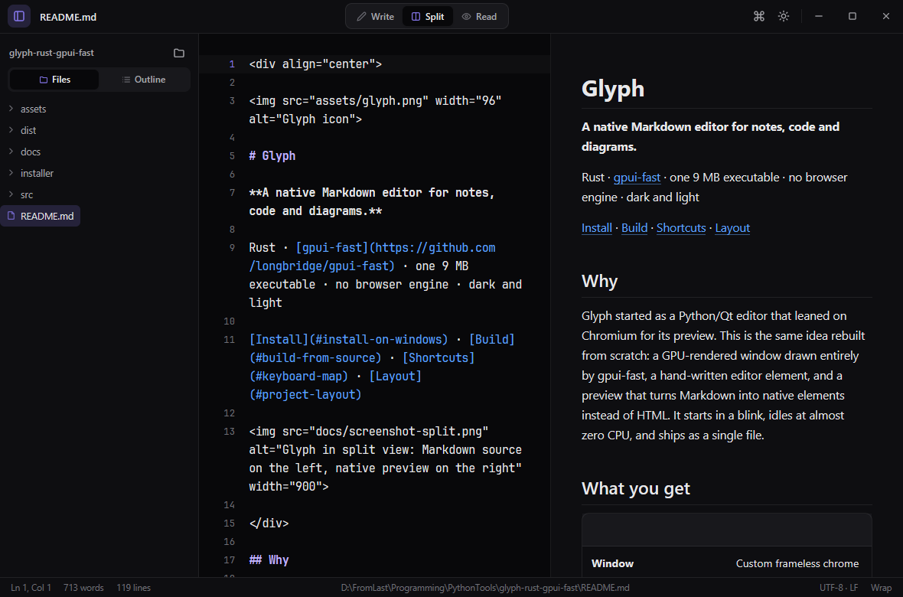
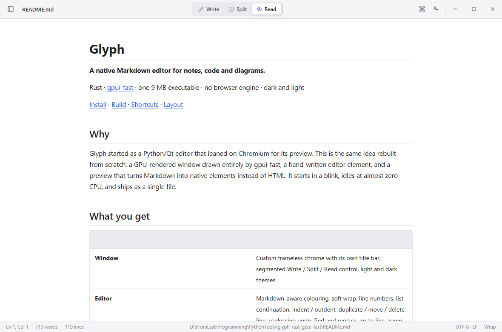

<div align="center">


# Glyph

**A native Markdown editor for notes, code and diagrams.**

Rust · [gpui-fast](https://github.com/longbridge/gpui-fast) · one 9 MB executable · no browser engine · dark and light

[Install](#install-on-windows) · [Build](#build-from-source) · [Shortcuts](#keyboard-map) · [Layout](#project-layout)



</div>

## Why

Glyph started as a Python/Qt editor that leaned on Chromium for its preview.
This is the same idea rebuilt from scratch: a GPU-rendered window drawn
entirely by gpui-fast, a hand-written editor element, and a preview that turns
Markdown into native elements instead of HTML. It starts in a blink, idles at
almost zero CPU, and ships as a single file.

## What you get

| | |
| --- | --- |
| **Window** | Custom frameless chrome with its own title bar, segmented Write / Split / Read control, light and dark themes |
| **Editor** | Markdown-aware colouring, soft wrap, line numbers, list continuation, indent / outdent, duplicate / move / delete line, coalescing undo, find and replace, go to line, zoom |
| **Preview** | Headings, paragraphs, lists, task lists, tables, block quotes, highlighted code blocks with a copy button, local raster images, clickable links. Scrolls with the editor; double-click a block to jump to its source |
| **Workspace** | Sidebar with a Markdown file tree and a document outline, tabs, command palette, status bar, focus mode, session restore |
| **Files** | UTF-8 with BOM and line-ending preservation, atomic saves, conflict detection, standalone HTML export |

Mermaid blocks show their source in the native preview. The HTML export renders
them through the Mermaid CDN.

<div align="center">

</div>

## Install on Windows

```powershell
git clone https://github.com/Master0fFate/glyph.git
cd glyph
.\install.cmd
```

`install.cmd` builds the release binary with Cargo if `dist\glyph.exe` is
missing, then runs `installer\install.ps1`, which

- copies `glyph.exe` to `%LOCALAPPDATA%\Programs\Glyph`,
- adds a Start Menu entry and an Apps & Features uninstall entry,
- makes Glyph the default for `.md`, `.markdown`, `.mdown`, `.mkd`, `.mmd` and `.mermaid`,
- adds Glyph to *Open with* for `.txt`.

Everything is written to the current user's registry hive, so no administrator
prompt appears. Uninstall from *Settings › Apps* or run
`%LOCALAPPDATA%\Programs\Glyph\uninstall.ps1`; it restores the previous
defaults.

`installer\glyph.iss` is an Inno Setup 6 script for building a conventional
`GlyphSetup.exe` with the same associations.

## Build from source

Needs a stable Rust toolchain (edition 2024) and, on Windows, the Visual
Studio C++ build tools.

```powershell
cargo build --release
.\target\release\glyph.exe README.md
```

Linux and macOS compile too (gpui-fast supports Wayland, X11 and Metal), but
only Windows has been exercised so far.

## Keyboard map

| Action | Shortcut |
| --- | --- |
| New / Open / Save / Save as / Close | `Ctrl+N` / `Ctrl+O` / `Ctrl+S` / `Ctrl+Shift+S` / `Ctrl+W` |
| Open folder | `Ctrl+Shift+O` |
| Command palette | `Ctrl+Shift+P` |
| Find / Replace / Go to line | `Ctrl+F` / `Ctrl+H` / `Ctrl+G` |
| Bold / Italic / Inline code / Link | `Ctrl+B` / `Ctrl+I` / `Ctrl+E` / `Ctrl+K` |
| Code block / Mermaid block | `Ctrl+Shift+C` / `Ctrl+Shift+M` |
| Write / Split / Read | `Ctrl+1` / `Ctrl+2` / `Ctrl+3` |
| Toggle theme / Sidebar | `Ctrl+Shift+L` / `Ctrl+\` |
| Next / Previous document | `Ctrl+Tab` / `Ctrl+Shift+Tab` |
| Focus mode / Word wrap | `F11` / `Alt+Z` |
| Duplicate / Delete / Move line | `Ctrl+D` / `Ctrl+Shift+K` / `Alt+↑` `Alt+↓` |
| Zoom | `Ctrl+=` / `Ctrl+-` / `Ctrl+0` |
| Export HTML | `Ctrl+Shift+E` |

## Project layout

```text
src/main.rs        entry point, fonts, key bindings, window options
src/workspace.rs   title bar, tabs, sidebar, panes, find bar, palette, status bar
src/editor.rs      editor entity, text input, custom render element
src/buffer.rs      line buffer with coalescing undo
src/highlight.rs   Markdown and code tokenizer shared by editor and preview
src/markdown.rs    pulldown-cmark to a block model with source lines
src/preview.rs     block model to GPUI elements
src/document.rs    UTF-8 reading, atomic writes, conflict checks
src/files.rs       workspace file tree
src/settings.rs    persisted preferences and session
src/theme.rs       dark and light tokens
installer/         install.ps1, uninstall.ps1, glyph.iss
```

Settings live in `%APPDATA%\Glyph\Glyph\config\settings.json`.

## License

MIT. gpui-fast is Apache-2.0.
